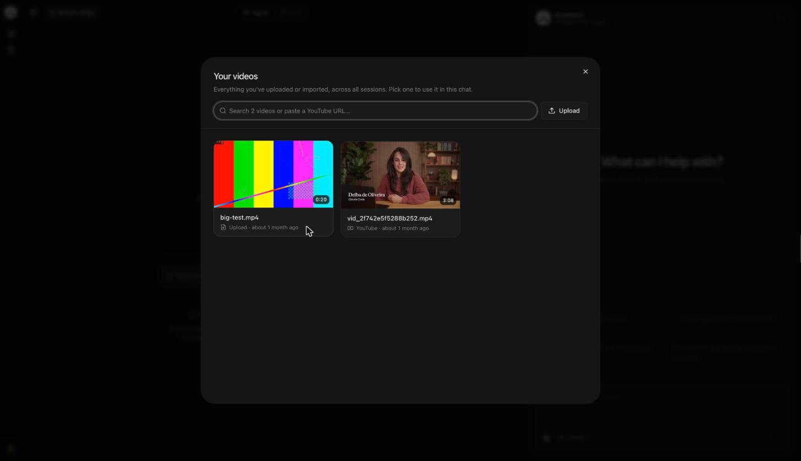
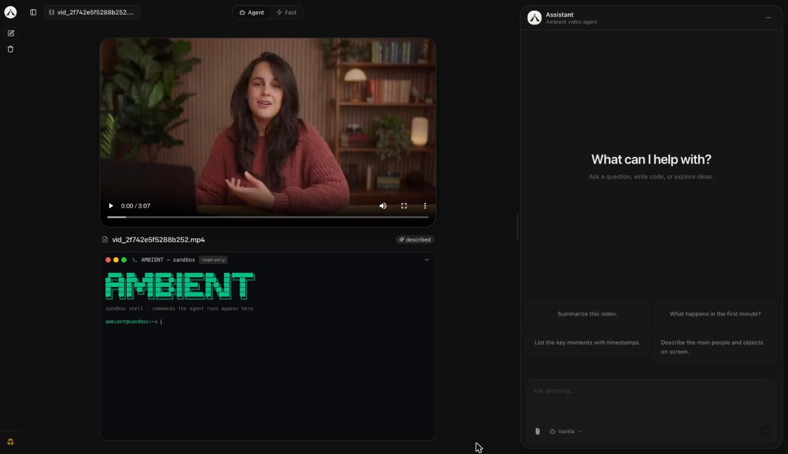
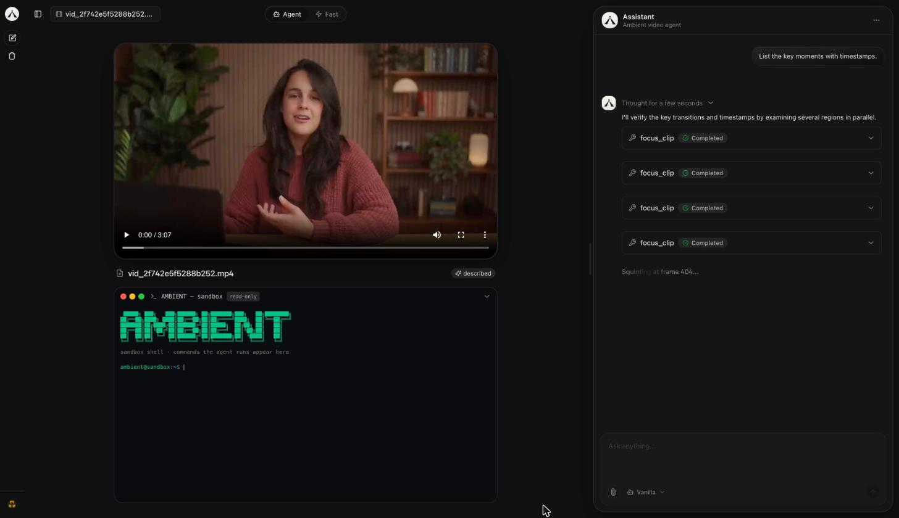
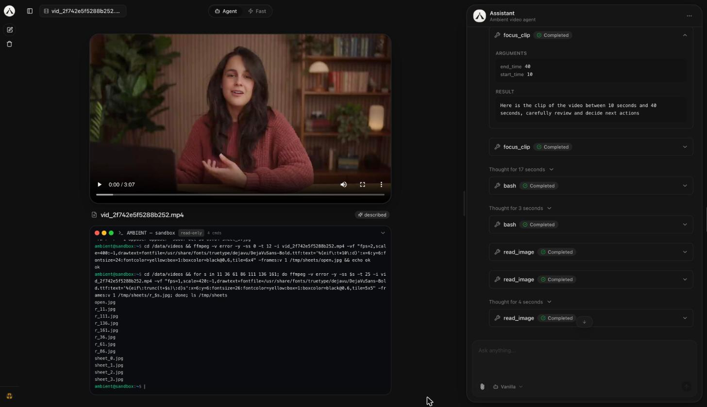
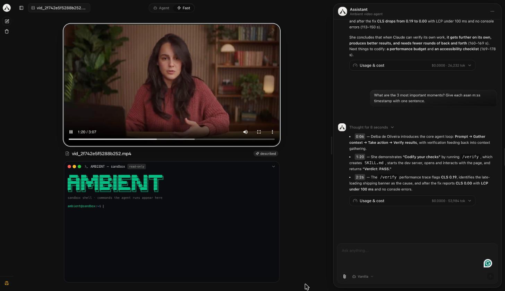
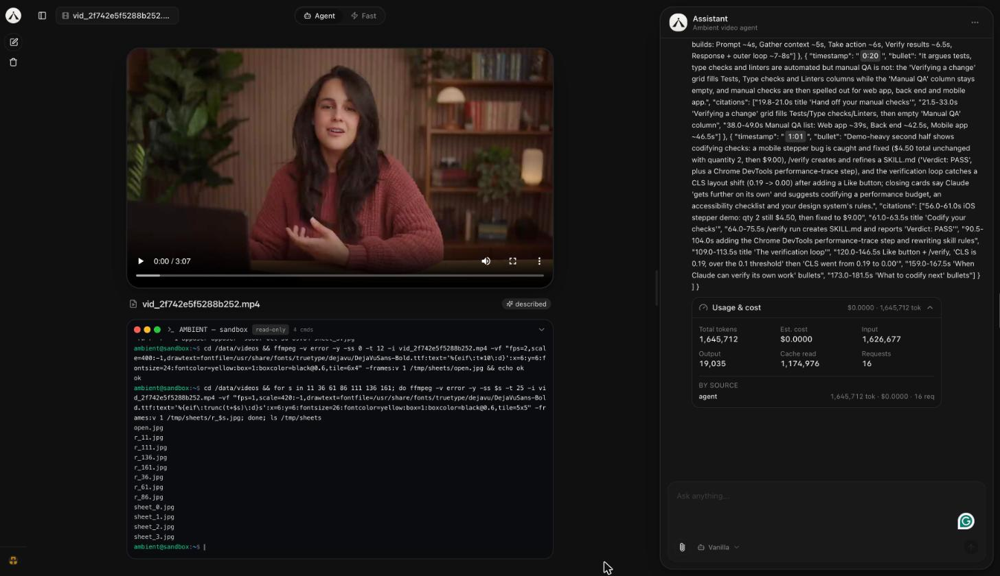
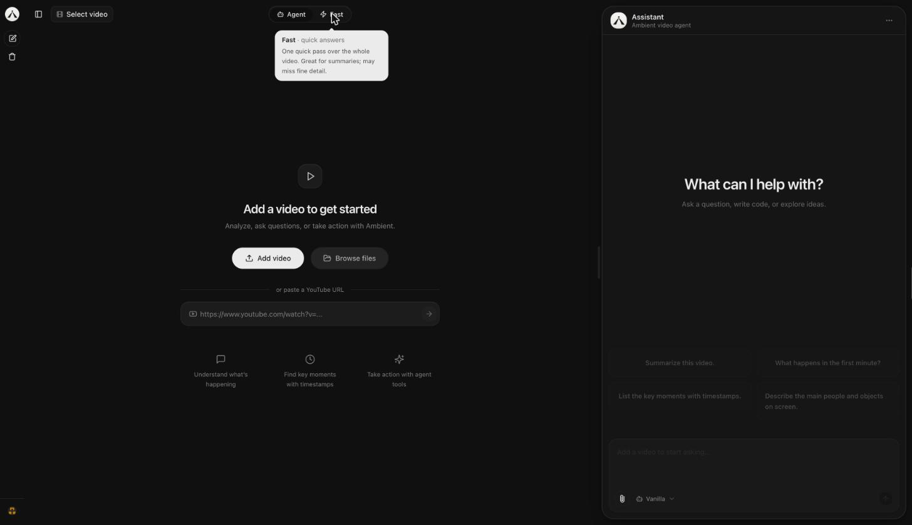
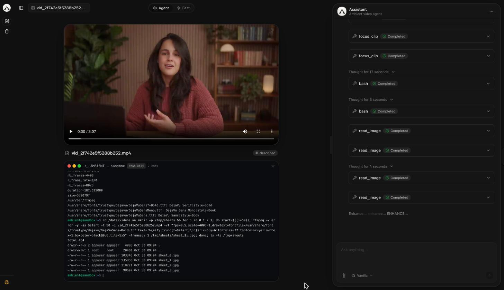
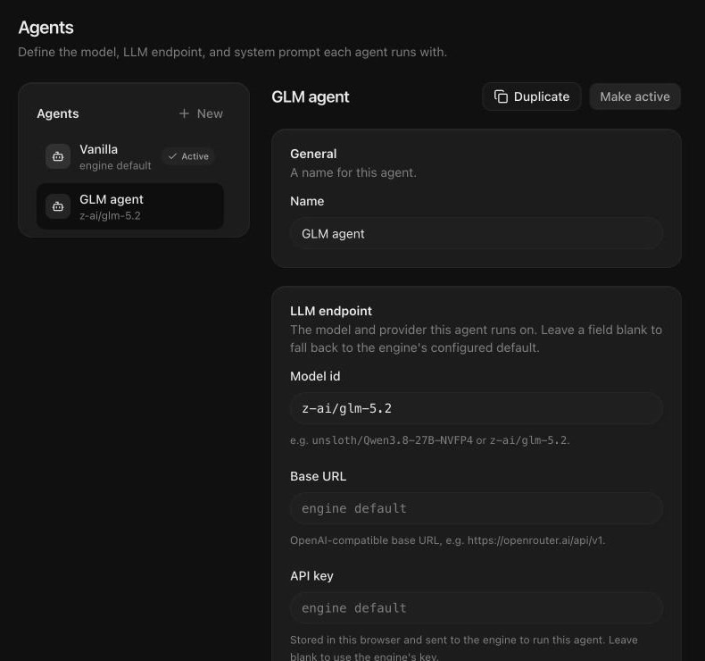

import { Steps, Aside, LinkCard } from '@astrojs/starlight/components';

This page walks through one complete example: adding a video, asking a question about it, and following the answer back to the moments it cites. The sections after it cover the rest of Studio.

You need a running Studio connected to an engine. If you don't have one yet, start with [Studio setup](../setup/).

## The layout

Studio has three areas:

- **The sidebar** on the left: **New chat**, your chat history, and your user menu.
- **The stage** in the middle: the video player, with the sandbox terminal under it. Above it, the header holds the video picker and the **Agent** / **Fast** toggle.
- **The Assistant panel** on the right: the conversation and the question box. Drag the grip on its left edge to make it wider or narrower. Studio remembers the width.

## Ask a question about a video

<Steps>

1. **Start a new chat.**

   Click **New chat** in the sidebar. Every new chat opens on the **Add a video to get started** stage.

2. **Choose a mode.**

   The toggle at the top of the stage sets how the engine works on this chat:

   - **Agent** (*thorough*) digs into clips and frames with tools. It's slower, but precise: timestamps, counts, exports.
   - **Fast** (*quick answers*) makes one quick pass over the whole video. It's good for summaries but may miss fine detail.

   Keep **Agent** for this example. The mode is fixed when the chat sends its first question.

3. **Add a video.** Pick one of these:

   - Click **Add video** and choose a file, or drop a video file anywhere on the stage. The button shows **Uploading N%**, then **Preparing…**.
   - Click **Browse files** to reuse a video that's already in the engine. See [The video library](#the-video-library).
   - Paste a YouTube link into the **or paste a YouTube URL** field and press the arrow button. The player shows **Importing from YouTube…** while the engine downloads it.

   

4. **Look over the stage.**

   When the video is ready, it takes over the stage. The filename shows in the title row and in the header's video picker. Once the engine has described the video, a **described** badge appears next to the title.

   The question box on the right is now enabled, and four suggested questions appear above it.

   

5. **Ask a question.**

   Type a question in the **Ask anything...** box and press Enter, or click a suggested question. For this example, click **List the key moments with timestamps.**

   The chat now has its own address, `/chat/<id>`, and appears in the sidebar.

6. **Watch the agent work.**

   The answer builds up in the Assistant panel as the engine streams it:

   - **Status lines.** While the engine is between steps, a shimmering line shows what's happening, such as *Waiting...* or *Thinking...*, or a playful filler like *Scrubbing the timeline...*.
   - **Thinking blocks.** Each step's reasoning streams into its own block. When the step finishes, the block collapses to *Thought for N seconds*. Click it to read the reasoning again.
   - **Tool calls.** Each tool the agent runs appears as a card with the tool's name, such as `focus_clip`, and a status badge: **Pending**, **Running**, **Completed**, or **Error**. Which tools you see depends on the engine's model and settings.
   - **Sandbox commands.** If the agent runs shell commands, they show up live in the terminal under the player. See [The sandbox terminal](#the-sandbox-terminal).

   

   Click a tool card to expand it. **Arguments** lists what the agent passed to the tool, such as the start and end times of the clip it looked at. **Result** shows what the tool returned.

   

   <Aside type="tip">
   You can reload the page or close the tab during a run. The engine keeps working. When you open the chat again, Studio replays the run and follows it to the end.
   </Aside>

7. **Jump to the moments it cites.**

   In the answer, every timestamp (`1:05`, `01:02:30`, or "12 seconds") is a highlighted chip. Click one: the player seeks to that moment, starts playing, and briefly flashes a ring around the video so you can see what changed.

   

8. **Check what the run cost.**

   Under the answer, the **Usage & cost** bar shows the estimated cost and total tokens for the run. Expand it for input, output, and cache-read tokens, the number of model requests, and a **By source** breakdown.

   

9. **Ask a follow-up.**

   Type another question in the same chat. Studio reuses the chat's engine session, so the agent keeps the context of the earlier turns and the same video.

</Steps>

Hover over an answer to copy it or rate it with the thumbs up and thumbs down buttons.

## The video library

Open the library from **Browse files** on the empty stage, or from the video picker in the header, which shows the current video's name (or **Select video**). The **Your videos** dialog lists every video in the engine, uploaded or imported, across all chats.

- Each card shows a preview frame, the duration, the source (**Upload** or **YouTube**), and when it was added. Hover a card to play a muted preview. The video open in this chat is marked **Current**.
- Type in the search box to filter by filename.
- Paste a YouTube URL into the same box and click **Import video**, or press Enter, to import it.
- Click **Upload** to add a file from your computer.
- Videos that are still importing show **Importing…**. Failed imports show **Import failed** and can't be picked.

Click a card to use that video. A chat stays tied to the video it started with, so when the current chat already has a video, picking or dropping a different one opens a new chat about it.

## Agent and Fast modes

The **Agent** / **Fast** toggle sits at the top of the stage. Hover over either option to see what it does.

| Mode | How it works | Use it for |
| --- | --- | --- |
| **Agent** | A multi-step tool loop: the agent searches and focuses on clips and frames before it answers. | Precise questions: timestamps, counts, specific details. |
| **Fast** | A single dense-frame pass over the whole video, with no tools. | Quick summaries and broad questions. |

Your choice is saved in the browser and applies to the next chat you start. A chat keeps the mode it began with.

## The sandbox terminal

Under the player, **AMBIENT — sandbox** mirrors the shell commands the agent runs, such as `ffmpeg` or `ffprobe` calls, along with their output, as if you were watching the sandbox shell. It's **read-only**: you can watch, but you can't type into it.

- The title bar shows how many commands have run in this chat.
- Click the title bar to collapse or expand the terminal. Studio remembers your choice.
- The terminal reads from the conversation, so it works live and also when you reopen an old chat.

Commands appear only when the engine's `bash` tool is turned on. It's on by default; see the [configuration reference](../../reference/configuration/).

## Chats and history

- The sidebar groups your chats under **Today**, **Yesterday**, **Last 7 days**, **Last 30 days**, and **Older**. Click one to reopen it with its video and full conversation.
- Each chat has its own URL, `/chat/<id>`, so you can bookmark it.
- To delete a chat, open its **⋯** menu in the sidebar and choose **Delete**. To clear everything, click **Delete all** under **New chat**.
- Chats belong to your browser's guest user, so they don't follow you to another browser. Videos live in the engine and are shared by every chat.

<Aside type="tip">
Type `/` in the question box for quick commands: `/new` starts a new chat, `/theme` switches between dark and light mode, `/delete` deletes the current chat, and `/purge` deletes all chats.
</Aside>

## Customize the agent

By default, Studio runs the engine's built-in agent with the engine's configured model, endpoint, and system prompt. To try a different model or prompt without touching the engine, create an agent definition.

<Steps>

1. Open **Settings**. Click the **⋯** button in the Assistant panel's header and choose **Settings**, or go to `/settings`.

2. Under **Agents**, select **Vanilla**, the built-in definition with no overrides, and click **Duplicate**. You can also click **New**.

3. Fill in the fields you want to change. Leave a field blank to use the engine's default.

   - **Name**: how the agent shows up in Studio.
   - **Model id**: the model to run, for example `z-ai/glm-5.2`.
   - **Base URL**: an OpenAI-compatible endpoint, for example `https://openrouter.ai/api/v1`.
   - **API key**: the key for that endpoint.
   - **System prompt**: instructions that steer how the agent answers.

4. Click **Save changes**, then **Make active**.

</Steps>

You can also switch agents from the agent picker in the question box's footer. It lists every definition and links to **Manage agents**. Like the mode, the active agent applies when a new chat sends its first question.

<Aside type="caution">
Agent definitions, including any API key you enter, are stored in this browser and sent to the engine to run the agent. They don't sync to other browsers.
</Aside>

**Settings → About** summarizes this: the LLM endpoint is configured on the engine and shared by all agents unless a definition overrides it, and agent definitions are stored in the browser.

## Appearance

- Collapse or expand the sidebar with the panel button at the top left.
- Switch between dark and light mode from the user menu at the bottom of the sidebar (it shows **Guest**). Studio follows your system theme until you choose.

## Next steps

<LinkCard title="SDK quickstart" description="Do what Studio does from your own code, with the Anthropic SDK." href="../../sdk/quickstart/" />
<LinkCard title="Configuration reference" description="Engine models, endpoints, tools, and sandbox settings." href="../../reference/configuration/" />
